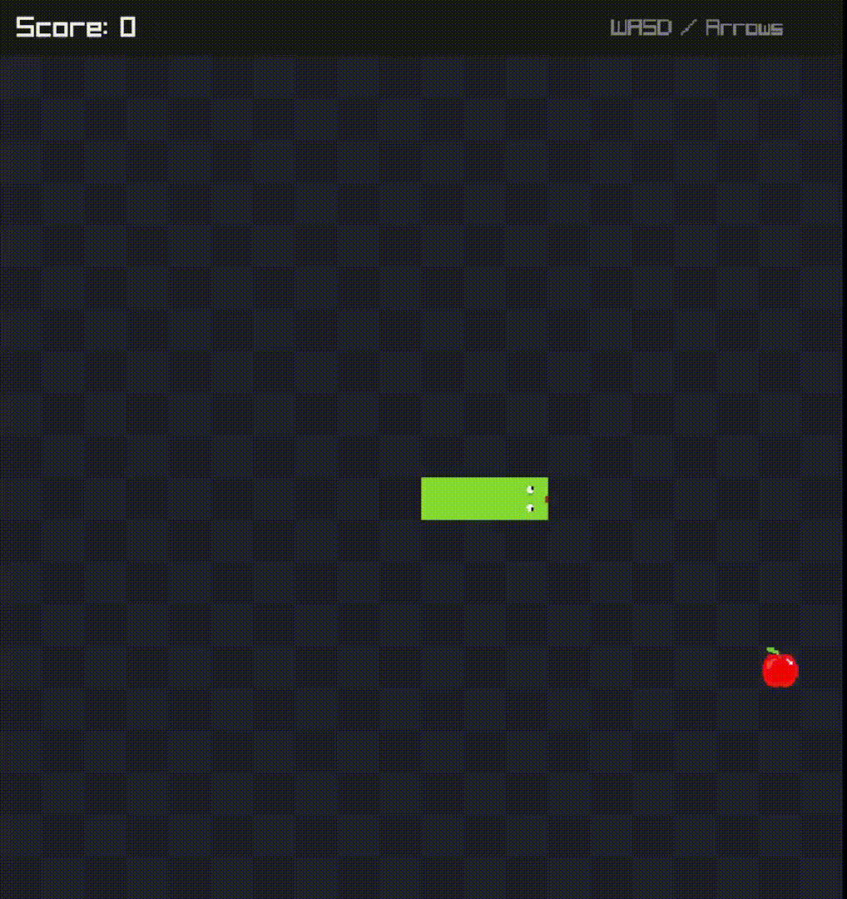

# Snake Game (C++ / Raylib)



A lightweight implementation of the classic Snake game written in C++ with [raylib](https://www.raylib.com/). Built around grid-based board state management, snake movement, collision detection, and custom pixel art sprites.

## Features

- **20×20 Grid Board:** Renders a 20×20 playing field (`_gameboard[20][20]`) with checkerboard tiles and custom pixel art textures (`snake_head.png`, `snake_body.png`, `snake_tail.png`, `apple.png`).
- **Apple Spawning:** Randomly selects coordinates on the board and places an apple (`A`), ensuring it only spawns on unoccupied spaces (`.`).
- **Board Space Validation:** Includes boundary/occupancy verification (`checkIfBoardHasEmptySpace()`) to prevent infinite loops when the board becomes full.
- **Collision & Score Tracking:** Handles wall and self-collision detection, score tracking, a Game Over overlay, and instant restart (`R`).

## Code Overview

The core logic is encapsulated within the `SnakeGame` class:

| Member / Method | Type | Description |
| :--- | :--- | :--- |
| `struct s` | Public Struct | Defines 2D coordinates (`cor_x`, `cor_y`) for tracking snake segments. |
| `_gameboard[20][20]` | Private Array | Stores the current state of each cell on the grid. |
| `snakeBody` | Private Vector | `std::vector<s>` storing the snake's body coordinates from head to tail. |
| `reset()` | Public Method | Resets score/state, clears the board, initializes the snake, and spawns an apple. |
| `clearBoard()` | Public Method | Fills the 20×20 grid with empty space characters (`.`). |
| `checkIfBoardHasEmptySpace()` | Public Method | Scans the grid and returns `true` if at least one empty cell (`.`) exists. |
| `randGenerateApple()` | Public Method | Places an apple (`A`) at a random available coordinate on the grid. |
| `moveSnake(char direction)` | Public Method | Updates snake position, checks wall/self collisions, handles apple eating, and updates the board. |
| `getCell()` / `getSnakeBody()` / `getScore()` / `isGameOver()` | Public Methods | Read-only getters used by the raylib rendering loop. |

## Getting Started

### Prerequisites
- A C++ compiler supporting C++11 or later (e.g., `g++`, `clang++`, or MSVC).
- [raylib](https://www.raylib.com/) installed and linked.

### Compilation & Execution

```bash
# Compile the source code (Linux / macOS)
g++ -std=c++11 raylib_main.cpp -lraylib -o snake

# Run the executable
./snake
```
