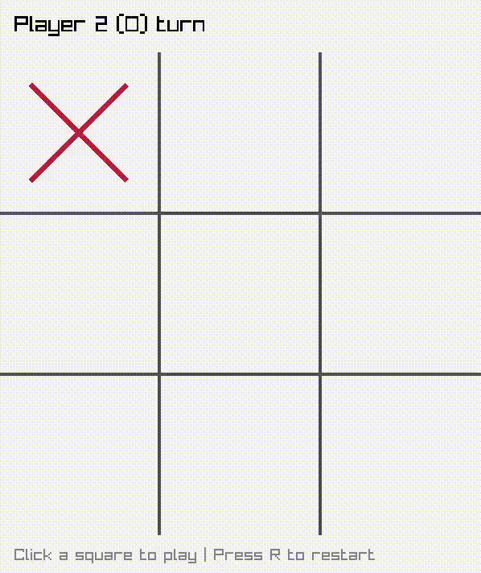

# Tic-Tac-Toe (C++ & raylib)

A Tic-Tac-Toe game written in C++. It started as a console version and was expanded with a graphical window using **raylib** on Windows.

## Features
- 3x3 board (`char[3][3]`) with win and draw detection
- Random assignment of `X` and `O` between players
- Mouse-driven gameplay and instant restart (`R`) in the raylib window



## Run Console Version

```bash
g++ main.cpp -o main.exe
.\main.exe
```

## Run raylib Version (Windows)

```powershell
& C:\raylib\w64devkit\bin\g++.exe raylib_test.cpp -o raylib_test.exe -I"C:\raylib\raylib\src" -L"C:\raylib\raylib\src" -lraylib -lopengl32 -lgdi32 -lwinmm
.\raylib_test.exe
```

## Planned Improvements
- [ ] Add an AI opponent (random moves or Minimax)
- [ ] Add score tracking across rounds
